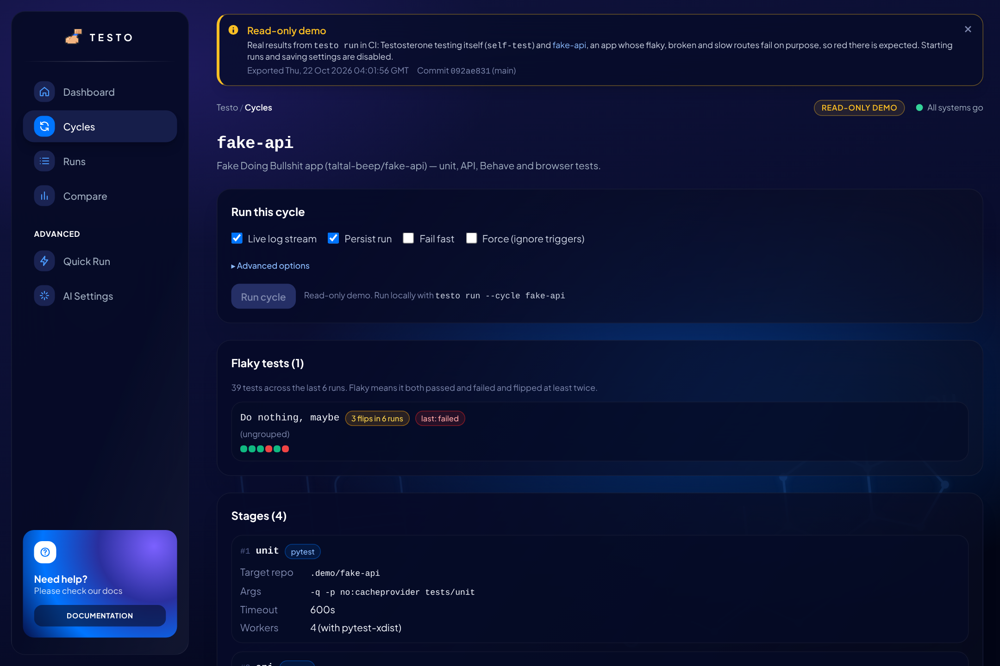
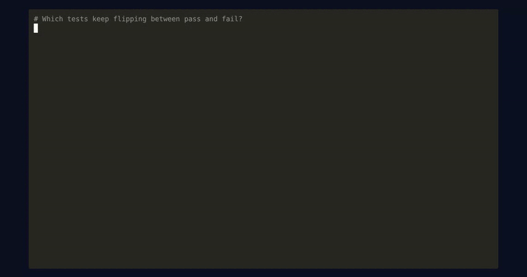

# Testosterone

**See what broke, what's flaky and what got slower on every run.** Test history, run-to-run diffs and flaky detection for pytest, Playwright, Jest, `go test` or any runner that writes JUnit XML: on your laptop, in CI, or on one shared server for the whole team.

[](https://github.com/taltal-beep/testosterone/actions/workflows/ci.yml)
[](https://github.com/taltal-beep/testosterone/actions/workflows/pages-demo.yml)
[](https://pypi.org/project/testo-core/)

[](LICENSE)

**Live demo: <https://taltal-beep.github.io/testosterone/>** · **Docs: <https://taltal-beep.github.io/testosterone/docs/>**

[](https://taltal-beep.github.io/testosterone/)

| Run detail (failed fake-api run) | Compare (two fake-api runs) |
|---|---|
| [](docs/assets/screenshots/run-detail-failed-fake-api.png) | [](docs/assets/screenshots/compare-fake-api-runs.png) |
| **Cycle page with its flaky tests** | **Dashboard on a phone** |
| [](docs/assets/screenshots/cycle-detail-fake-api.png) | <a href="docs/assets/screenshots/dashboard-phone.png"></a> |

What you're looking at: Testosterone testing itself (its own test suite) and `fake-api`, a
small app whose routes fail on purpose. CI runs both cycles and publishes the real results as a
read-only static site.

<details>
<summary><strong>Watch a walkthrough of the UI</strong> (animated, under a minute)</summary>


</details>

## What's new

Added since v1.1.1:

- **`testo ingest`: bring any runner.** Keep your CI as it is and add one step after the tests:
  `testo ingest 'reports/**/*.xml' --cycle web`. JUnit XML from Jest, Vitest, `go test`, JUnit5
  or anything else becomes a recorded run with history, Compare, `testo flaky` and the PR
  comment. No `testosterone.yaml` needed.
- **Team server.** `docker compose up` in [deploy/server/](deploy/server/) starts the API, the
  web UI and Postgres in one place; CI jobs upload with `testo ingest --server URL --token ...`
  so the whole team shares one history. Guide: [Team Server](docs/Processes%20&%20Guides/Team%20Server.md).
- **Lighter install.** `pip install testo-core` no longer pulls in Behave, BehaveX and Allure-Behave.
  Behave users add the extra: `pip install 'testo-core[bdd]'`.
- **Flaky test detection.** `testo flaky --cycle <name>` lists tests that keep flipping between
  pass and fail across a cycle's recent runs (`--fail-on-flaky` to gate CI), and the cycle page
  in the UI shows them too.
- **Pull request comments.** The GitHub Action writes the run, its failing tests and what changed
  since the previous run to the job summary, and with `comment-on-pr: "true"` keeps one comment
  per cycle on the pull request. The text comes from `testo report markdown`.
- **Plugins.** Add your own test runner or reporter from any package through the
  `testo.frameworks` / `testo.reporters` entry points; `testo plugins` lists what is installed.
  [examples/plugin/](examples/plugin/) is a complete one.
- **Playwright.** `equipment: playwright` runs `npx playwright test` with its JUnit and HTML
  reporters wired in, so its tests count in summaries, diffs and the UI with no extra setup.
- **A restyled web UI** (navy glass cards, a sidebar on desktop) and a
  [docs site](https://taltal-beep.github.io/testosterone/docs/) with a
  [Getting Started](docs/Getting%20Started.md) guide.
- **Fixes:** a `pip install`ed `testo-core` keeps its run data in `./.testo/` (or `$TESTO_HOME`)
  instead of `site-packages`, and BehaveX stages keep BehaveX's own full HTML report.

<details>
<summary><strong>See the new commands</strong>: <code>testo flaky</code>, <code>testo report markdown</code> and <code>testo plugins</code> on the fake-api cycle</summary>



</details>

Full list in [CHANGELOG.md](CHANGELOG.md).

## Why

After a red build the question is never just "what failed?". It's *what changed since the last
green run, is this test flaky, and did anything get slower?* CI logs and one-off HTML reports
can't answer that, because they forget every run as soon as it ends. Testosterone records every
run and answers it: per-test regressions and fixes between runs, flaky tests, durations over
time, a test pyramid and an optional AI summary of the failures.

There are two ways in. **`testo ingest`** records JUnit XML that your existing CI already writes,
so adoption is one extra step. **`testo run`** goes further: it runs several frameworks as one
**cycle** of stages from a `testosterone.yaml` (pytest, Playwright, Behave, any command), the
same way from the CLI, CI or the web UI. Point either at a shared
[team server](docs/Processes%20&%20Guides/Team%20Server.md) and every CI job lands in one history.

**How it compares.** Allure renders one run; ReportPortal is a large server to operate.
Testosterone is a `pip install` that keeps the history and diffs runs against each other, works
with whatever runner you have, and can still hand results to Allure, ReportPortal, Extent or
TestBeats as reporters.

<picture>
  <source media="(prefers-color-scheme: dark)" srcset="docs/assets/testosterone-architecture-detailed-dark.png">
  
</picture>

What ships: the `testo` CLI (`--ci` streams NDJSON events, exit codes `0`–`4`), a FastAPI
backend (`testo_api`, `/api/v1`, live runs over server-sent events), a React frontend
(`frontend/`), and GitHub Action / GitLab CI wrappers around `testo run --ci`. See
[ARCHITECTURE.md](ARCHITECTURE.md) for how the pieces fit.

## Quickstart

Install the CLI from PyPI and point it at your own tests:

Already have tests that write JUnit XML? Record them, no config needed:

```bash
pip install testo-core
npx jest --ci --reporters=default --reporters=jest-junit   # or pytest --junitxml, go test, ...
testo ingest 'junit*.xml' --cycle web                      # recorded; run again to see the diff
testo summary --cycle web
```

Or let Testosterone run the tests as a cycle:

```bash
pip install testo-core            # the `testo` CLI; add [api] for the REST API, [db] for Postgres,
                                  # [bdd] for Behave and BehaveX
testo config init                 # writes a starter testosterone.yaml; edit its stages
testo run --cycle smoke-test      # run a cycle from it
```

An installed `testo` keeps per-run report copies in `./.testo/` (set `TESTO_HOME` to move them).

[Getting Started](docs/Getting%20Started.md) goes further in about five minutes: a regression
between two runs, then the same cycle in GitHub Actions.

Or work from a checkout of this repository, which ships sample cycles:

```bash
git clone https://github.com/taltal-beep/testosterone.git
cd testosterone
python -m venv .venv && source .venv/bin/activate
pip install -e ".[dev]"

testo run --cycle sample-pytests      # run a cycle from testosterone.yaml
testo report --cycle sample-pytests   # build the Allure report for it
```

<details>
<summary><strong>Watch it run</strong>: install, <code>testo doctor</code>, then a cycle against the deliberately broken fake-api app</summary>


</details>

Adding Testosterone to your own project with an AI coding assistant? Paste one of the
[Setup Prompts](docs/Prompts%20&%20Snippets/Setup%20Prompts.md).

Runs are stored in SQLite by default (`database.url` in `testosterone.yaml`, or
`DATABASE_URL`). Postgres and MySQL work too; `docker compose up -d postgres` starts one.

### UI

```bash
testo-api                              # FastAPI on http://127.0.0.1:8000
npm --prefix frontend install
npm --prefix frontend run dev          # React on http://localhost:5173
```

Pages: Dashboard, Cycles (run any cycle and watch its stages live, see its flaky tests), Runs and Run Detail
(reports, test pyramid, AI summary), Compare (delta between two runs), Quick Run (run one
framework against a repo without defining a cycle) and AI settings.

## Defining cycles

```yaml
version: 1
defaults:
  target_repo: .
  artifacts_root: artifacts
  timeout_s: 600
reporters:
  - type: allure
cycles:
  smoke:
    description: Unit tests, then BDD flows.
    trigger:                     # optional: skip unless these paths changed
      paths: ["src/**", "tests/**"]
    stages:
      - name: unit
        equipment: pytest
        args: [-q, tests/unit]
      - name: flows
        equipment: behave
        args: [features/smoke.feature]   # always target Behave features explicitly
      - name: browser
        equipment: playwright            # npx playwright test, JUnit + HTML report wired in
        args: [tests/e2e]
      - name: web
        equipment: command               # any runner; results come from JUnit XML
        args: [npx, jest, --ci]
        junit_xml: ["reports/junit/*.xml"]
```

Built-in `equipment`: `pytest`, `behave`, `behavex`, `playwright`, `command` and `junit` (records
JUnit XML another step wrote; what `testo ingest` uses). `behave` and `behavex` need
`pip install 'testo-core[bdd]'`. A package can add more (see [Plugins](#optional-integrations)).

`testo config validate` checks the file; `testo init` writes one interactively. The full
schema and every flag are in [Command Reference](docs/CLI%20Commands/Command%20Reference.md).

## CLI

| Command | What it does |
|---------|--------------|
| `testo run --cycle <name>` | Run a cycle (`--ci` NDJSON, `--stream` live output, `--force` ignore triggers, `--no-persist`) |
| `testo ingest <files> --cycle <name>` | Record JUnit XML from any runner as a run (`--server`/`--token` upload to a team server) |
| `testo report …` | Generate, list, open and export reports (`testo diff` compares two archived runs) |
| `testo report markdown --cycle <name>` | The latest run as Markdown: results, failing tests, changes since the previous run (job summary or PR comment) |
| `testo summary` | Rich diff of the two most recent runs (`--cycle` to pick one) |
| `testo cycles list/show` | Inspect configured cycles |
| `testo watch --cycle <name>` | Re-run a cycle when files change |
| `testo flaky --cycle <name>` | Tests that keep flipping between pass and fail across recent runs (`--fail-on-flaky` for CI) |
| `testo plugins` | Built-in and installed frameworks and reporters (`--check` imports them, `--json`) |
| `testo doctor` | Check config, database and tools on PATH |

Exit codes: `0` success (or trigger-skipped), `1` tests failed, `2` invalid input,
`3` infrastructure failure, `4` internal error.
Details: [Troubleshooting and Error Codes](docs/CLI%20Commands/Troubleshooting%20and%20Error%20Codes.md).

## API

| Area | Endpoints (`/api/v1`) |
|------|-----------------------|
| Cycles | `GET /cycles`, `GET /cycles/{cycle}` |
| Executions | `POST /cycles/{cycle}/executions`, `POST /adhoc-executions`, `GET /cycle-executions/{id}`, `GET /cycle-executions/{id}/events` (SSE) |
| Ingest | `POST /ingest` (JUnit XML upload from `testo ingest --server`) |
| Runs | `GET /runs`, `GET /runs/{id}`, `GET /runs/{id}/reports`, `GET /runs/{id}/pyramid` |
| Analytics | `GET /analytics/delta`, `GET /analytics/delta/cases`, `GET /analytics/flaky`, `GET /dashboard/overview`, `GET /dashboard/runs/recent` |
| AI (bring your own key) | `GET /ai/config/status`, `PUT /ai/config`, `GET /runs/{id}/ai-summary`, `POST /runs/{id}/ai-summary:generate` |
| Health | `GET /health/live`, `GET /health/ready` |

Interactive docs at `http://127.0.0.1:8000/docs` while `testo-api` runs.

## CI

GitHub Actions:

```yaml
- uses: taltal-beep/testosterone/integrations/github-action@v1
  with:
    cycle: smoke          # optional: config-path, ci-mode, persist, python-version
    comment-on-pr: "true" # results as a pull request comment (needs pull-requests: write)
```

GitLab CI (a GitLab mirror of this repo is coming; until then, include the template straight
from GitHub, or copy [ci/gitlab/testo.gitlab-ci.yml](ci/gitlab/testo.gitlab-ci.yml)):

```yaml
include:
  - remote: "https://raw.githubusercontent.com/taltal-beep/testosterone/v1/ci/gitlab/testo.gitlab-ci.yml"
variables:
  TESTO_CYCLE: "smoke"
```

Both run `testo run --ci`, keep the NDJSON event stream, and expose the final `plan_finished`
event (exit code, per-stage results). The GitHub Action also writes the run to the job summary
(`job-summary`, on by default) and, with `comment-on-pr`, keeps one up-to-date comment per cycle
on the pull request: results per stage, failing tests and per-test changes since the last run. Run records written in CI carry the provider, pipeline,
job, commit and branch. Inputs and outputs: [integrations/github-action/README.md](integrations/github-action/README.md).

## Optional integrations

- **Metrics push:** after each run, test KPIs go to InfluxDB when `INFLUXDB_URL`,
  `INFLUXDB_TOKEN`, `INFLUXDB_ORG` and `INFLUXDB_BUCKET` are set, and to a Prometheus
  Pushgateway when `PROMETHEUS_PUSHGATEWAY_URL` is set (`PROMETHEUS_JOB_NAME` defaults to `testo`).
  Pushes are best-effort and never change the run result.
- **Reporters:** `allure`, `extent`, `reportportal`, `testbeats` under `reporters:`.
- **Plugins:** a package adds a test runner or a reporter through the `testo.frameworks` /
  `testo.reporters` entry point groups, with no change to Testosterone; `testo plugins` lists and
  checks them. [examples/plugin/](examples/plugin/) adds a `unittest` runner and a
  `json-summary` reporter.
- **AI failure summaries:** opt in on the AI settings page with an OpenAI or Anthropic key.
  Failed runs store their failing cases, first traceback and log tail (redacted), which is
  what the summary is built from.

## Development

```bash
pip install -e ".[dev]"
pre-commit install
ruff check .
ruff format --check .
mypy testo_core testo_api
pytest -q -m "tier_fast and not quarantined" --no-cov
npm --prefix frontend run typecheck
npm --prefix frontend test
```

`ruff check`, `ruff format --check` and `mypy testo_core testo_api` are all blocking in CI
(`.github/workflows/ci.yml`'s `format` job), as are the frontend typecheck and tests.

See [CONTRIBUTING.md](CONTRIBUTING.md) for the full checklist. Start with
[ARCHITECTURE.md](ARCHITECTURE.md) for the design; [docs/](docs/Index.md) holds the design
notes and ADRs, also published as the [docs site](https://taltal-beep.github.io/testosterone/docs/)
(`pip install -e ".[docs]"` and `mkdocs serve` to preview it).

## Contributors

Thank you to everyone who has helped make Testosterone better:

| Contributor | Contributions |
|-------------|---------------|
| [@taltal-beep](https://github.com/taltal-beep) | Creator and maintainer |
| [@evidentart](https://github.com/evidentart) | Run history records the repository each run tested ([#115](https://github.com/taltal-beep/testosterone/pull/115), fixes [#102](https://github.com/taltal-beep/testosterone/issues/102)) |

Want to join them? The [good first issues](https://github.com/taltal-beep/testosterone/labels/good%20first%20issue)
are a friendly place to start, and [CONTRIBUTING.md](CONTRIBUTING.md) walks you through the setup.

## History

The project started as UQO ("Unified Quality Orchestrator") and was renamed to Testosterone
(the `uqo` command and `UQO_*` variables became `testo` and `TESTO_*`). v1.1 replaced the Streamlit UI
with the React frontend and dropped the Docker-based headless runner (stages now run as host
subprocesses). Full details in [CHANGELOG.md](CHANGELOG.md).

<details>
<summary>Migrating from v1.0</summary>

| v1.0 | v1.1 |
|------|------|
| Streamlit UI (`testo-ui`, `streamlit run app.py`) | React frontend (`frontend/`) |
| `uqo` command, `UQO_*` env vars | `testo`, `TESTO_*` |
| `uqo run --config runs.yaml` (`runs:` list of `test_type`/`cli_args`) | a cycle in `testosterone.yaml`, run with `testo run --cycle <name>` |
| `--ghost`, `--json`, `--stream-json` | `--ci` (NDJSON events, `plan_finished` last) |
| `POST /api/v1/executions` + `/executions/{id}/events` | `POST /api/v1/adhoc-executions` (one framework) or `POST /api/v1/cycles/{cycle}/executions`; status and SSE under `/cycle-executions/{id}` |
| "Legacy Execution" page | Quick Run (`/quick-run`) |
| Tests run in one-off Docker containers (`UQO_RUNNER_IMAGE`, `UQO_RUNNER_PREBUILT`) | stages run as host subprocesses; use `Dockerfile.testo-runner` as the CI job image if you want isolation |
| Allure results uploaded to MinIO per run | per-run reports under `static/history/<run_id>/` (served at `/history`) and the report archive DB |
| `locust` test type | `equipment: command` with `args: [locust, --headless, …]` |
| Pluggy `plugins/*.py` runner hooks | a framework adapter or reporter in your own package, registered as a `testo.frameworks` / `testo.reporters` entry point (see `examples/plugin/`) |

</details>
